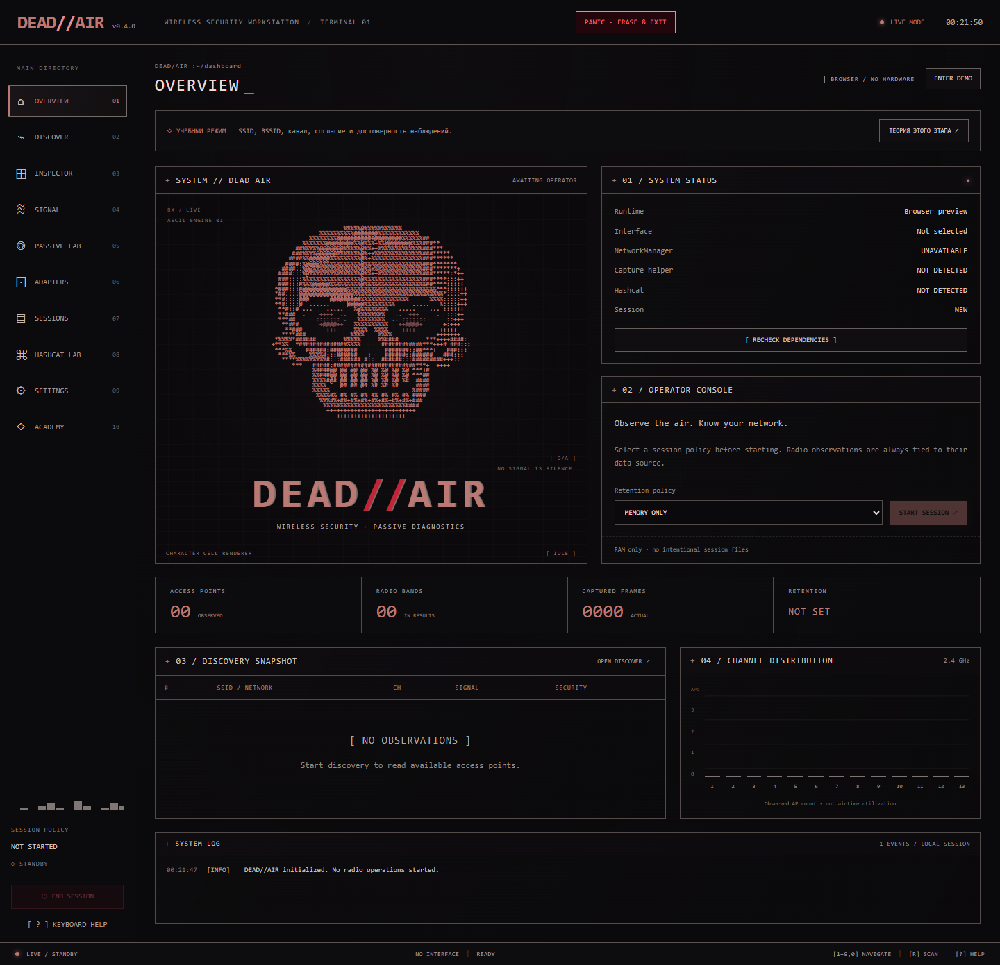
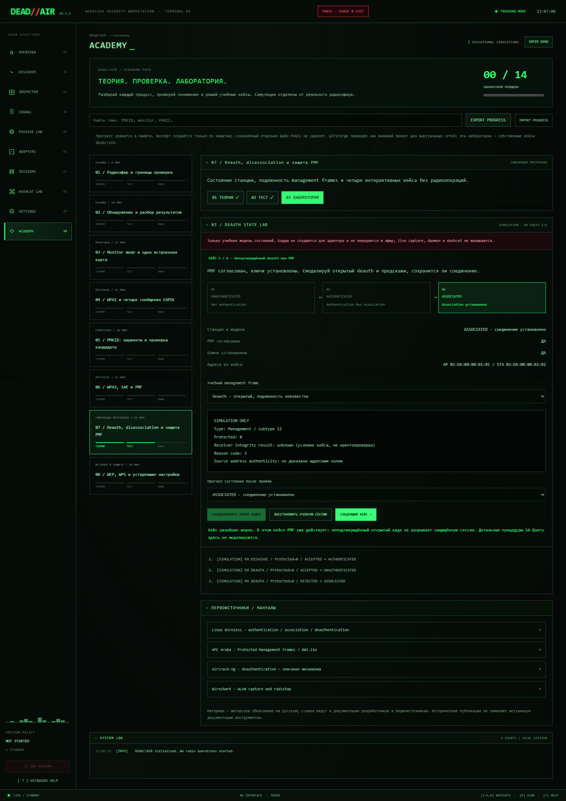

<div align="center">

# DEAD//AIR

### The air remembers.

**A Linux Wi-Fi diagnostics workstation and learning lab.**<br>
Rust / Tauri · React / TypeScript · Phosphor green · Crimson eyes

[](https://github.com/Japhet17429475581/DEAD-AIR/actions/workflows/linux.yml)
[](CHANGELOG.md)
[](docs/BUILDING.md)
[](LICENSE)

[Features](#features) · [Get started](#get-started) · [Academy](#academy) · [Build](docs/BUILDING.md) · [Verification](#verification-and-current-limits)



*Version 0.3.1 browser preview. Native diagnostics are unavailable in the browser; no radio results are fabricated.*

</div>

DEAD//AIR brings real Linux wireless tools into a desktop GUI with interactive tables, process output, explicit storage policies, and an integrated Academy. Its interface borrows from old CRT workstations: deep black, phosphor green, restrained distortion, and a frame-animated ASCII skull that reacts to application events.

**Forbidden software atmosphere. Professional software behavior.**

LIVE mode reports native results and errors. DEMO mode is a separate, explicitly enabled source of sample data. Academy simulations are labeled and do not transmit radio frames. Use radio workflows only on networks and devices you own or have permission to assess.

> **Development release:** the native backend and Linux packages are implemented. Physical Wi-Fi capture, driver transitions, MAC restoration, and reconnect recovery still need acceptance testing on real Linux hardware.

**0.3.2 adapter fix:** capture now reuses the selected interface, avoiding a second virtual-interface requirement. Existing monitor interfaces are accepted and retain their original mode. Driver/collector errors are preserved in a selectable GUI panel. See [the fix and verification notes](docs/CAPTURE-TROUBLESHOOTING.md).

## Features

| Area | What is implemented |
| --- | --- |
| **Discovery** | NetworkManager D-Bus discovery, `iw` adapter inventory, filtering, sorting, target inspection, and channel snapshots. |
| **Passive observation** | Selected-BSSID/frequency observation through `airodump-ng`, actual packet counters, bounded parsing, EAPOL correlation, passive PMKID observations, and PCAPNG export. |
| **Adapter control** | Monitor-mode workflows, explicit consent before disconnecting a connected built-in card, saved-profile restoration, recovery controls, and MAC address profiles. |
| **Hashcat Lab** | Native SHA-256 benchmarks, device checks, cancellation, and owner-generated known-answer jobs. |
| **Sessions** | Memory-only, verified tmpfs, temporary, and persistent storage; private session directories and scoped cleanup. |
| **Privilege separation** | Regular-user GUI and a scoped on-demand daemon, authorized through polkit once per working session. No administrator password storage or arbitrary shell interface. |
| **Dependency setup** | Startup inventory and GUI installation of missing tools from configured distribution repositories after review and system authorization. |
| **Academy** | 14 modules with theory, quizzes, guided cases, a real WebCrypto PMKID teaching vector, and a simulated deauth/PMF state lab. |
| **CRT character** | Fixed-grid ASCII artwork, independently animated jaw, event reactions, optional audio, and reduced-motion support. |

NetworkManager discovery can send ordinary probe requests. The separate passive capture workflow waits for naturally occurring traffic and does not force clients to reconnect. EAPOL correlation is **not cryptographic handshake verification**.

## Get started

### Build the Linux application

```sh
git clone https://github.com/Japhet17429475581/DEAD-AIR.git
cd DEAD-AIR
bash scripts/bootstrap.sh --dry-run
bash scripts/bootstrap.sh
bash scripts/package.sh
```

The bootstrap script shows build dependencies before installing them. It supports **Ubuntu, Debian, Fedora, and Arch Linux**. Packaging produces DEB/RPM bundles or a local Arch package, including the privileged helper and polkit policy. See the [English build and test guide](docs/BUILDING.md) for prerequisites, output paths, and platform limits.

Install the resulting package, then launch **DEAD AIR** from the application menu as a regular user. On first launch, review missing tools and select **INSTALL DEPENDENCIES**. Administrator authorization is handled by Linux; the GUI stays unprivileged.

Hashcat is optional. **INSTALL CPU RUNTIME** in Hashcat Lab can install PoCL. GPU drivers and wordlists are not downloaded. Package-manager and network errors remain visible and can be retried.

Prebuilt packages are not committed to this source repository. The Linux workflow uploads build artifacts when its job succeeds. AppImage is not currently distributed because the helper requires system installation.

### Preview the interface

Requires **Node.js 22.12+**:

```sh
npm ci
npm run dev
```

Open **http://127.0.0.1:1420/**. Browser previews cannot perform native Linux operations. To explore sample networks, choose **ENTER DEMO → ENABLE DEMO MODE → START SESSION → DISCOVER NETWORKS**. Academy is available separately without a radio session.

Most operational UI labels are English. Academy lessons are currently written in Russian; navigation has English/Russian options. An English README does not imply a fully translated Academy.

## Academy

**Understand the protocol → check your understanding → work through a lab.**

| Path | Topics |
| --- | --- |
| **Foundations** | Radio observations, SSID/BSSID, scope and consent, discovery, managed/monitor mode, and restoring connectivity. |
| **Protocols** | WPA2/EAPOL, PMKID, WPA3/SAE, PMF, deauthentication versus disassociation, and historical WEP/WPS risks. |
| **Systems** | MAC/OUI limitations, Hashcat/OpenCL, Enterprise/EAP, privilege separation, session retention, and evidence reporting. |

The PMKID sandbox computes an explicit teaching vector with WebCrypto. The deauth lab is an offline station-state model with four cases: disassociation, unprotected deauthentication, PMF rejection, and a legitimate protected teardown. **There is no real deauth transmission feature.**

Lessons link to primary documentation. WifiForge is credited as an external virtual-lab reference; DEAD//AIR's included cases are its own teaching components. Progress lives in memory and can be explicitly exported/imported.

<details>
<summary><strong>View the deauth / PMF teaching lab</strong></summary>



*Educational simulation. No adapter access, radio transmission, or privileged operation is triggered by this lab.*

</details>

## Sessions and privacy

| Mode | Behavior |
| --- | --- |
| **MEMORY ONLY** | No intentional session directory. File-based capture/export and Hashcat jobs are restricted. |
| **RAM SESSION** | Session files go to a validated private tmpfs directory. No disk fallback if validation fails. |
| **TEMPORARY** | Files may exist on disk while active and are removed on successful normal cleanup. A crash can leave recoverable data. |
| **PERSISTENT** | Session files remain available across application restarts until explicitly cleaned. |

**PANIC** stops application jobs, attempts adapter/MAC restoration, cleans the selected application-owned session scope, ends the daemon, and exits if cleanup succeeds. Its default scope includes persistent sessions. The shortcut is configurable and works while the application has focus.

Optional GNU `shred` is not a guarantee of irrecoverability on SSDs, copy-on-write filesystems, snapshots, or backups. RAM sessions can also be affected by swap and system crash dumps. PANIC does not erase system logs or copies exported elsewhere. Read the [privacy and recovery notes](docs/PRIVACY.md) before relying on a storage policy.

## Architecture

```text
React / TypeScript desktop GUI
             │ typed Tauri commands
             ▼
Rust backend ─── NetworkManager D-Bus / session storage
             ├── bounded packet parsing / PCAPNG export
             └── managed Hashcat laboratory processes
             │ restricted local protocol
             ▼
Scoped privileged daemon ← polkit authorization
             └── dependency installation / adapter operations / capture helper
```

Aircrack-ng and Hashcat are separately installed distribution tools. Their source is not copied into this repository. The daemon starts on demand and ends with the working session; it is not a general-purpose root shell.

## Verification and current limits

Recorded verification for **0.3.1** includes 23 frontend unit tests, three Academy browser scenarios, a release Linux build, DEB installation in a Debian container, and RPM generation. Earlier milestones also exercised real Hashcat with PoCL, isolated D-Bus integration, native WebKitGTK rendering, storage cleanup, and daemon authorization boundaries. These are development checks, not an independent security audit.

Still requiring validation:

- Physical discovery/capture, built-in Wi-Fi disconnection/reconnect, monitor-mode restoration, MAC changes, and USB removal across drivers.
- Desktop polkit dialogs and end-to-end dependency installation on all target distributions.
- Fedora RPM installation, Arch packaging/install, Wayland behavior, and GPU runtimes.

Current scope limits: no captured wireless-hash import/cracking workflow; no active PMKID elicitation; Kismet integration is limited to a local status/authentication check. MAC vendor profiles change an address, not the operating system or complete device fingerprint. Native radio operations target Linux; Windows/macOS can be used for frontend work.

## Development and documentation

```sh
npm test
npm run build
npm run test:e2e
cargo test --manifest-path src-tauri/Cargo.toml --locked --no-default-features
```

Browser tests use Google Chrome. Native checks require Linux prerequisites. For the isolated development skull preview, open **http://127.0.0.1:1420/?skull-preview=1**; it is excluded from production routes.

- [Build, install, test, and hardware acceptance — English](docs/BUILDING.md)
- [Contributing](CONTRIBUTING.md) · [Changelog](CHANGELOG.md)
- Detailed implementation notes **in Russian**: [Linux setup](docs/LINUX.md), [architecture](docs/ARCHITECTURE.md), [storage / daemon / PANIC](docs/PRIVACY.md), [Academy](docs/ACADEMY.md), [deauth model](docs/DEAUTH.md), [skull animation](docs/SKULL.md).
- Historical [0.1.0 verification report](docs/VERIFICATION.md). Local artifact references in historical reports are not included in this source checkout.

## License

[MIT](LICENSE). External tools and dependencies retain their respective licenses.
