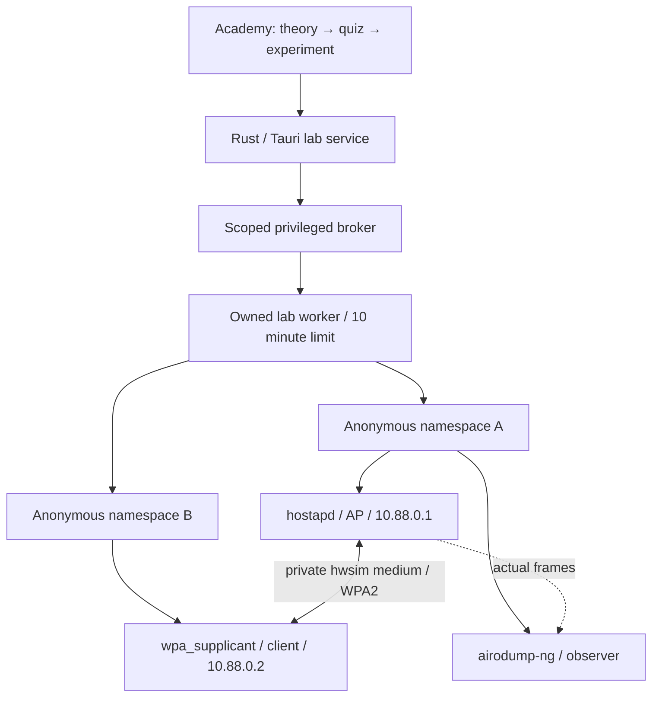

# Real virtual WLAN labs

Version 0.4.0 adds a native Rust lab runtime and the first real scenario, **WPA2 basics**. Open **ACADEMY → REAL VIRTUAL NETWORK LAB → lesson 15**, read the theory, pass the quiz, then open the lab. This feature requires the Linux desktop application; it is disabled in browser previews and DEMO mode.

The networks are software radios, but the protocol exchange is real: Linux `mac80211_hwsim` runs the Wi-Fi stack, `hostapd` runs the AP, and `wpa_supplicant` authenticates the client. A separate observer records actual frames. There is no timer-generated success or prerecorded packet replay. See the [Linux Wireless description of hwsim](https://wireless.docs.kernel.org/en/latest/en/users/drivers/mac80211_hwsim.html).

## Architecture and the WifiForge reference

The architectural review used [WifiForge commit 55951864bc5190b518160bc8152662714967cfb9](https://github.com/blackhillsinfosec/WifiForge/tree/55951864bc5190b518160bc8152662714967cfb9). Its useful organizing ideas are declarative lab metadata, reusable topologies, and a shared lifecycle around individual scenarios. The relevant files are [`_schema.py`](https://github.com/blackhillsinfosec/WifiForge/blob/55951864bc5190b518160bc8152662714967cfb9/src/wififorge/labs/_schema.py), [`_harness.py`](https://github.com/blackhillsinfosec/WifiForge/blob/55951864bc5190b518160bc8152662714967cfb9/src/wififorge/labs/_harness.py), [`_scenarios.py`](https://github.com/blackhillsinfosec/WifiForge/blob/55951864bc5190b518160bc8152662714967cfb9/src/wififorge/labs/_scenarios.py), and [`runtime.py`](https://github.com/blackhillsinfosec/WifiForge/blob/55951864bc5190b518160bc8152662714967cfb9/src/wififorge/runtime.py).

DEAD//AIR implements its own Rust runtime. It does not embed WifiForge, Mininet-WiFi, Python services, tmux, or Open vSwitch. The small Python file in `scripts/verify-virtual-lab.py` is exclusively a VM integration test driver.

| Layer | Responsibility |
| --- | --- |
| `src/academy/VirtualLab.tsx` | Guided experiment, topology, real status, dependency installation and explicit completion criteria. |
| `src-tauri/src/virtual_lab/mod.rs` | Unprivileged service; bounded JSON protocol, process lifecycle, packet parsing and optional PCAPNG export. |
| `src-tauri/src/virtual_lab/linux.rs` | Privileged fixed scenario; namespaces, AP/client processes, evidence collection and owned-resource cleanup. |
| `src-tauri/src/virtual_lab/netlink.rs` | Bounded generic-netlink requests for hwsim radio leases and moving the client wiphy. |
| Existing broker | UID/token authentication and a whitelist of fixed operations. No GUI-supplied commands, configuration files, arbitrary interface names or executables. |



All three radios originate in the same newly created network namespace and hwsim netgroup. The client wiphy is then moved to a second namespace; this separates the IP stacks while retaining the private virtual medium. There is no external NIC, default route, NAT or bridge. Physical adapters and existing virtual radios are not selected or reset. The AP uses channel 6, CCMP and the public teaching password `LabOnly-2003!`.

The netlink implementation uses the [Linux hwsim UAPI](https://github.com/torvalds/linux/blob/v6.1/drivers/net/wireless/mac80211_hwsim.h) and [`nl80211.h`](https://github.com/torvalds/linux/blob/v6.1/include/uapi/linux/nl80211.h). Each radio requests `DESTROY_RADIO_ON_CLOSE`; the worker retains its creation socket until cleanup. The module is loaded with `radios=0` if necessary and is left loaded afterward. Existing module users are never unloaded.

## Experiment and completion criteria

1. **Create:** authorize the isolated topology. Wait for the real AP to report `ENABLED`.
2. **Scan:** the client performs an actual `iw` scan and must discover the owned AP BSSID. Wait until the observer receives AP frames before connecting.
3. **Connect:** start the owned supplicant with the known teaching key. Observe the actual EAPOL exchange.
4. **Verify:** send ICMP from the client's separate namespace through the WLAN to the AP.
5. **Stop:** terminate the owned processes and remove the owned radios and runtime files. Optionally export retained frames into an active RAM/temporary/persistent audit session.

Completion requires **all** of: AP `ENABLED`, a scan that found its BSSID, client `COMPLETED`, AP station `AUTHORIZED`, correlated M1–M4, and successful client-to-AP IP connectivity. Packet correlation alone is not MIC verification. The GUI independently checks the evidence flags and message set before crediting the Academy module.

An observer that was not ready for the exchange must not produce a passing result. Start a fresh lab to repeat the experiment. There is no frame injection or real deauthentication attack action.

## Dependencies on Linux

Use **INSTALL LAB TOOLS** in the lesson. The GUI uses the existing polkit-authorized dependency installer with a separate fixed package profile:

| Distribution | Lab tools installed from configured repositories |
| --- | --- |
| Ubuntu / Debian | `hostapd wpasupplicant iw iproute2 aircrack-ng iputils-ping kmod` |
| Fedora | `hostapd wpa_supplicant iw iproute aircrack-ng iputils kmod` |
| Arch | `hostapd wpa_supplicant iw iproute2 aircrack-ng iputils kmod` |

The **running kernel** must also provide `mac80211_hwsim` (`CONFIG_MAC80211_HWSIM`). Preflight checks a loaded module or `modinfo mac80211_hwsim`. Package installation cannot add namespace capabilities to a restricted container. WSL/Docker kernels often omit this module; use a full Linux VM or desktop with a suitable kernel.

Kernel package names depend on kernel flavour and distribution. On Ubuntu, check the matching `linux-modules-extra-$(uname -r)` package; Debian's full `linux-image-amd64` kernel is the tested VM route. On Fedora, identify the package matching the running kernel with `dnf provides '*/mac80211_hwsim.ko*'`; on Arch, check the file list for the installed kernel package and reboot after kernel upgrades if `/lib/modules/$(uname -r)` no longer matches. DEAD//AIR does not silently replace or reboot the operating-system kernel. Consult the distribution's package records: [Ubuntu](https://packages.ubuntu.com/), [Debian](https://packages.debian.org/linux-image-amd64), [Fedora](https://packages.fedoraproject.org/pkgs/kernel/), [Arch](https://archlinux.org/packages/core/x86_64/linux/files/).

The GUI remains unprivileged. The existing broker requests system authorization when first needed and is reused during its working session. The lab does not store a system password.

## Retention and cleanup

Runtime configurations, bounded logs and the intermediate capture are root-owned under `/run/deadair/virtual/<operation UUID>`, on **verified tmpfs**. No disk fallback is used. This lab staging area is separate from audit-session retention: even without an audit session, the lesson explicitly authorizes temporary tmpfs files. At most 4096 frames are retained in the GUI backend for an explicit later export; the display keeps only the last 40 packet rows. Root capture and service logs are size-bounded, and the scenario stops after 10 minutes.

STOP, session close, normal window close and PANIC stop the lab. Cleanup only removes known files inside the owned operation directory and checks that owned radios disappeared. Unknown files or links cause a visible cleanup error. On abrupt worker death, socket leases and parent-death signals release radios/processes; **RECOVER OWNED LAB** checks the same UID's stale manifests and process start identities before removing remaining runtime files. It refuses to recover a live worker or another UID's lab.

The observer and AP processes may produce normal kernel/system-level logging. This feature does not promise forensic erasure, swap exclusion or removal of exported copies. See [storage and PANIC limits](PRIVACY.md).

## Reproducing the real integration test

Use a disposable **Debian build container** with the repo mounted at `/work`. After the native build prerequisites, install `qemu-system-x86 linux-image-amd64 busybox-static cpio hostapd wpasupplicant iproute2 iw aircrack-ng iputils-ping tcpdump kmod`. Then:

```sh
cargo build --manifest-path /work/src-tauri/Cargo.toml --locked --no-default-features --bin deadair-capture-helper
install -D -m 0755 /absolute/target/debug/deadair-capture-helper /usr/libexec/deadair-capture-helper
bash /work/scripts/verify-virtual-lab-vm.sh /absolute/target/debug/deadair-capture-helper
```

The harness boots a real Debian kernel under QEMU TCG, exports a read-only guest root, creates tmpfs runtime mounts, and supplies **no external NIC or host radio**. It deliberately starts a foreign hwsim AP before the lab, checks that the lab cannot see it, exercises scan → WPA2 association → M1–M4 → ping, then checks normal cleanup, a second run, forced worker death and stale-runtime recovery while preserving the foreign radios. Results and serial output go to ignored `artifacts/virtual-lab-vm/`.

It also checks an actual UID 1000 broker client and cleanup when that client's stdin closes. Install the same helper in the disposable container before testing: the broker always launches the installed `/usr/libexec/deadair-capture-helper`, and the harness rejects mismatched binaries. This does not test a graphical polkit dialog.

Frontend IPC fixtures validate the GUI contract; they are explicitly labeled test fixtures and are not evidence that the Linux stack works. Keep their results separate from the QEMU integration result.

## Next scenarios

The runtime currently supports **one fixed topology and one real scenario**. Additional real scenarios are planned, not implemented:

1. Extend the typed scenario catalogue and expected evidence without accepting arbitrary root configuration from the GUI.
2. Add isolated multi-AP discovery/channel exercises and a PMF comparison using normal owned-client state transitions.
3. Add controlled WPA3/SAE and Enterprise/EAP topologies with their own capability probes, certificates, evidence checks and teardown tests.
4. Add reproducible reset/checkpoint support and per-scenario grading before exposing a broader lab catalogue.

Each scenario needs its own actual stack integration test. The existing deauth lesson remains an offline model; no real deauth transmitter is planned for this runtime.
